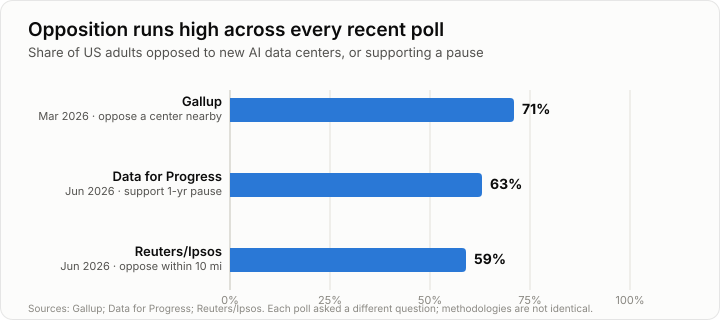
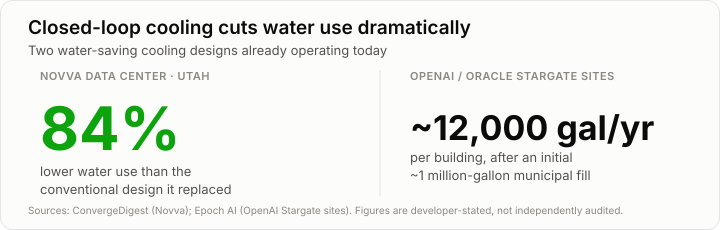

I carry a phone that runs on models trained inside buildings full of GPUs, and most days I use chatbots built the same way. So, in all likelihood, do most of the people showing up at zoning meetings to stop the next one of those buildings from getting constructed down the road. That's the strange thing about the current fight over AI data centers: the people who want the output and the people who don't want the building are often the same person, just standing in different rooms on different nights. We want the smartphone, the search engine, and the coding assistant, and we don't want the thing that makes them possible anywhere near our water table, our power bill, or our bedroom window.

That tension has turned into one of the broadest, most genuinely bipartisan political fights in the country right now. It's not a coastal thing, a red-state thing, or a tech-industry-versus-everyone-else thing. It's showing up in New York executive orders, Texas grid moratoriums, Utah county votes, and petitions around the country, often pushed by politicians who agree on almost nothing else. The question worth asking isn't whether the backlash is real. It clearly is. The question is whether the answer should be to build fewer data centers, or to build the ones we need differently. Having gone through the actual numbers on power, water, noise, and the mitigation technology already deployed, I think the evidence supports the second answer, with real conditions attached.

## The political reality: this is not a fringe complaint

Let's start with how wide the opposition actually runs. Gallup's March 2026 poll found 71% of Americans oppose construction of an AI data center in their area, with 48% "strongly" opposed, which is a higher opposition rate than Gallup has ever recorded against nuclear power plants [[1]](#references). Reuters and Ipsos found 59% opposed to a data center within ten miles of their home [[2]](#references). What makes this more than ordinary NIMBYism is how little the opposition tracks party lines: a Data for Progress poll on pausing construction found support in the 60s among both Democrats and Republicans, and some reporting suggests the most conservative Republicans oppose data centers at rates closer to Democrats than to moderate members of their own party [[3]](#references). That's not the signature of a culture-war issue. It looks more like a populist fault line over corporate power and local control.

That sentiment has already reshaped governance in both parties. New York Governor Kathy Hochul signed an executive order in July 2026 imposing the nation's first statewide moratorium on discretionary environmental permits for data centers over 50 MW [[4]](#references). Virginia has a patchwork of county-level pauses and a state Senate bill for a three-year moratorium, complicated by a state Supreme Court ruling that blanket moratoria are generally impermissible, which is pushing localities toward zoning overlays and permit freezes instead [[5]](#references). Republicans have moved just as aggressively in the other direction's own backyard: Texas Governor Greg Abbott paused statewide grid-connection approvals for data centers pending more disclosure of power and water use, and President Donald Trump publicly criticized his own party's governor for it, calling the move a mistake [[6]](#references). Utah Governor Spencer Cox set eight evaluation principles for new projects, and New Hampshire Senate President Sharon Carson (R) announced the GOP majority would pursue its own moratorium "to protect New Hampshire taxpayers" [[7]](#references). Nottingham, New Hampshire voters approved a local moratorium by a landslide, 1,335 to 143 [[8]](#references).

The scale of actual project disruption backs up the polling. Industry tracker Industrial Info Resources counted 48 projects cancelled or delayed in 2025 alone, compared with just one in 2023, and the states with the largest cancellation value by dollar amount were Arizona, Virginia, Ohio, and Indiana, hardly a list of traditionally anti-business states [[9]](#references). A few specific dollar figures circulating in press coverage, including a cumulative figure near $156 billion and individual project withdrawal amounts attributed to specific companies, trace back to a single secondary aggregator rather than primary reporting, so I'd treat those as directionally indicative rather than confirmed.

So the objections aren't coming from a small, vocal minority, and they aren't sorted neatly by party. The next question is whether they're actually justified by the facts on the ground, or whether this is simply fear of something new and large.

## The complaints are measured, not imagined

They're measured. On electricity costs, three separate state regulatory proceedings show the cost-shifting risk to residential customers is real, not hypothetical. Dominion Energy's 2025 Virginia rate filing proposed adding $10.51 a month to residential bills while creating a dedicated data center rate class requiring at least 85% of contracted demand to be paid for regardless of actual usage [[10]](#references). Ohio's utility regulator approved a nearly identical AEP Ohio tariff in July 2025 [[11]](#references), and unlike Dominion's filing or Georgia's pledge, that one is already showing up in bills: Columbus's typical residential electric bill rose about $27 a month over the summer of 2025, an increase local reporting tied directly to the data center buildout straining the regional grid [[12]](#references). Georgia regulators built in a similar safeguard for a different reason: when the Public Service Commission approved Georgia Power's $16 billion plan to add generation capacity, roughly 90% of it earmarked for data center demand, the company had to pledge its 2028 rates for a typical residential customer would be at least $8.50 a month lower than they'd otherwise be [[13]](#references). That pledge is worth separating from Georgia Power's other recent history: the company's residential bills had already climbed about $43 a month since 2022 through six separate rate cases, but those increases were driven mainly by cost overruns on the Plant Vogtle nuclear expansion and a 2022-2023 spike in fuel prices, not by data centers [[14]](#references). The data center-specific commitment is the $8.50 pledge tied to the new capacity, not the broader run of increases that came before it. Three independent regulators building ratepayer safeguards, in two cases through direct take-or-pay tariffs and in Georgia's case through a pledged rate offset, at roughly the same time is still meaningful evidence the cost-shifting risk is real, even with that distinction drawn.

These three states aren't the whole picture, just the clearest documented examples. PJM, the regional grid operator serving thirteen Mid-Atlantic and Midwest states, saw its capacity auction price rise roughly tenfold year over year, with data center demand estimated to account for 63% of that increase; one advocacy group projects the average family in PJM territory could see $70 a month in added costs by 2028 if regulators don't intervene, though that's a forward-looking estimate, not a measured bill impact like the Columbus figure above [[15]](#references). Other states are addressing the same problem through different levers rather than a take-or-pay tariff: Oregon created the first dedicated data center utility rate class, Texas now requires data centers to cover grid costs up front rather than through general rates, and Pennsylvania has a pending rate case aimed at shielding PPL's residential customers from data center cost-shifting [[16]](#references).

Water impacts are real but concentrated geographically rather than uniform nationally. In New Mexico, a single project, Project Jupiter, could consume up to 2,400 acre-feet (around 782 million gallons) a year, and if every currently planned data center in the state gets built, statewide data center water use would rise from just over 500 million gallons annually to 23.6 billion gallons [[17]](#references). Company disclosures show absolute water use climbing even as efficiency per unit of compute improves: Google's data center water use rose 28% in a single year to 30 billion liters in 2024, Microsoft's rose 34% to over 1.7 billion gallons, and Meta's rose 51% since 2020 [[18]](#references). That tells you the industry's efficiency gains are currently being outrun by sheer growth, even at the companies most publicly committed to reducing their footprint.

Noise complaints turn out to be grounded in measurable regulatory gaps rather than vague unease. Prince William County, Virginia's 60-decibel daytime noise limit was written decades before hyperscale cooling equipment existed, exempts air conditioning outright, and is reportedly exceeded routinely by cooling towers that can reach 70 dBA at 400 feet, while diesel backup generators can hit 105 dB [[19]](#references). In Lowell, Massachusetts, a state court paused installation of new diesel generators pending a legal challenge over an air quality permit [[20]](#references). On air emissions, the Southern Environmental Law Center has accused Amazon and Duke Energy of structuring permit applications for 649 diesel generators at a North Carolina site specifically to avoid Clean Air Act thresholds that would apply to a single consolidated permit, a structural permitting allegation rather than a dispute over emissions science [[21]](#references).

What ties these cases together is that they're not generalized fear of new infrastructure. They're specific instances of rules that didn't anticipate this scale: noise codes written for a different era, permits split to dodge a threshold, water allocations approved without accounting for how fast demand would grow. That's an argument for better rules, not necessarily for no buildings at all.

## Industry is already engineering around its own worst impacts

What separates this fight from earlier infrastructure battles is how quickly the mitigations have shown up, and how concrete some of them already are. On water, Microsoft committed in 2024 that all new data center designs will use closed-loop, zero-evaporative cooling, already piloted at sites in Phoenix and Mount Pleasant since August 2024 [[22]](#references). Novva's operating 175 MW Utah campus uses a proprietary water-free cooling system the company claims cuts water use by roughly 84% compared with conventional designs [[23]](#references). At least six OpenAI and Oracle "Stargate" sites use closed-loop systems requiring only an initial fill of around a million gallons of municipal water, after which each building needs an estimated 12,000 gallons a year [[24]](#references). Amazon has taken a different approach: expanding from 20 to a planned 120 data centers using reclaimed wastewater for cooling by 2030, rather than trying to eliminate water use altogether [[25]](#references). Those specific percentages and gallon figures are developer-stated, not independently audited, and "closed-loop, non-evaporative" has become close to boilerplate language in project announcements. What isn't boilerplate is the underlying engineering behind it: direct-to-chip liquid cooling, built into Nvidia's current reference architecture for its highest-end AI racks, is commercially shipping today, regardless of whether any single company's specific savings claim holds up under an audit.

On grid strain, dedicated and co-located generation has become the default answer to multi-year interconnection queues. Amazon's twenty-year, nearly 2 GW nuclear power agreement with Talen Energy at the Susquehanna plant anchors a $20 billion Pennsylvania investment the company calls its largest-ever state commitment [[26]](#references). Microsoft has gone further with a single plant: in 2024 it signed a 20-year agreement with Constellation Energy to restart the shut-down Three Mile Island Unit 1 reactor, rebranded the Crane Clean Energy Center, specifically to supply Microsoft's data center load [[27]](#references). It's worth being precise about what that deal actually is: the plant sells into the regional PJM grid under a power purchase agreement rather than running a dedicated wire to a single data center, so it's closer to a long-term financial claim on carbon-free generation than a plant built on-site. It's also not done yet. As of this writing the restart still needs Nuclear Regulatory Commission approval and isn't expected online before 2028 [[27]](#references). Bloom Energy's fuel cell agreements, including up to 2.8 GW contracted with Oracle and a $2.65 billion, 1 GW deal with AEP, are already in active deployment rather than paper commitments [[28]](#references). On noise specifically, Frederick County, Maryland required a 22-foot concrete sound wall around generator yards as a condition of approving a data center expansion, and Franklin County, Indiana's draft ordinance mandates 500-foot equipment setbacks and certified acoustic studies [[29]](#references)[[30]](#references), which tells you the strongest mitigation specifics right now are coming from local regulation, not voluntary pledges from the companies themselves.

Community benefit structures have also moved from negotiated extras to legally mandated requirements in several places. Illinois law now requires data center operators to sign community benefit agreements with minimum annual payments of at least 10% of the property taxes otherwise owed [[31]](#references), and a Pennsylvania township's agreement with a single developer could bring it more than $120 million [[32]](#references). None of this erases the counterexamples. Utah's Stratos project pairs water-saving cooling claims with a roughly 9 GW on-site gas plant, and there are documented cases of mitigation promises failing in practice at facilities already operating. But it does demonstrate that mitigation isn't a hope for the future. It's an active, and in several places legally required, construction practice right now.

## Where the technology is heading next

The next few years point toward meaningfully smaller footprints per unit of compute, not toward zero impact, and the timeline matters because some fixes are retrofittable into existing buildings while others need to be designed in from the start. Direct-to-chip liquid cooling is already the default reference architecture for frontier AI hardware, with vendor claims of dramatic water and energy efficiency gains over evaporative cooling that should be read skeptically as marketing figures, even though the underlying mechanism, coolant that recirculates in a closed loop without evaporating, is sound engineering rather than vaporware [[33]](#references). Uptime Institute's field analysis found that well-designed dry and adiabatic cooling can match evaporative cooling's efficiency across most temperate and cool climates with zero or near-zero water use, but there's a real tradeoff: full dry cooling carries a 25 to 35 percent power penalty, and that extra electricity carries its own upstream water and carbon footprint at the power plant generating it [[34]](#references). No cooling technology currently eliminates water use end to end. It just relocates where that water gets consumed.

Much of this is retrofittable rather than requiring new construction. Meta and Microsoft co-developed air-assisted liquid cooling specifically to add direct-to-chip cooling into existing air-cooled facilities without installing new water piping [[35]](#references), meaning older buildings don't have to be torn down to capture most of the gains. Demand-flexibility software is probably the most mature lever of all: Google's grid-interactive demand response tools have been in production since around 2020, and 2026 trade coverage describes regulators increasingly conditioning fast grid interconnection on data centers accepting curtailability during peak demand, moving the practice from pilot program to regulatory requirement [[36]](#references). Nuclear small modular reactors are the clear exception to this near-term optimism. Every agreement I found remains at the contract or letter-of-intent stage, with the earliest credible first-power date around 2030 and most committed capacity pushed well into the 2030s, so those deals should be described as announced infrastructure, not delivered infrastructure.

## The strategic backdrop: why Washington treats this as urgent

Part of what's driving federal pressure to build faster is a widely cited compute lead over China that administration officials and industry executives see as more fragile than the raw numbers suggest. RAND estimates the US controls roughly 75 to 77% of global AI GPU cluster capacity versus China's 12 to 15%, and Stanford's 2026 AI Index counted 5,427 US data centers against 449 in China [[37]](#references). The Trump administration's July 2025 AI Action Plan formally reclassified data centers, chips, and power infrastructure as national security assets and included an executive order specifically aimed at faster federal permitting [[38]](#references). Anthropic has stated the US will need at least 50 GW of new electric capacity for AI by 2028 to maintain its lead and has identified "years-long delays from overlapping federal, state, and local permits" as the binding constraint, while also explicitly saying the US should not adopt China's approach to permitting, arguing for speed without abandoning review altogether [[39]](#references). Nvidia CEO Jensen Huang has framed the competition across energy, chips, infrastructure, models, and applications, arguing the US leads decisively on chips and models but China leads on energy capacity and build speed [[40]](#references). I'd treat the specific claim that China permits projects in a matter of months against a roughly three-year US timeline as a widely repeated but not independently verified figure, worth citing as a common industry talking point rather than a confirmed fact.

That urgency narrative deserves a counterweight that's easy to miss. China's top-down planning model avoids US-style grassroots zoning fights, but it isn't friction-free: it has reportedly cancelled more than 100 data center projects between early 2024 and mid-2025 due to overcapacity, alongside local electricity caps and reported corruption in permitting [[41]](#references). Legal scholar Angela Huyue Zhang has argued the US should learn from China's overbuilding mistakes rather than race to replicate its speed, suggesting domestic opposition may function as a useful check against wasted capital rather than purely as an obstacle [[41]](#references). Neither the "we lose if we don't build faster" framing nor the "slow down and avoid China's mistakes" framing is fully settled by the evidence here. Both are contested expert positions, not established fact, and a thoughtful policy shouldn't lean entirely on either one.

## Longer-term bets: orbit, ocean, and fusion

Everything above is deliberately bounded to what's already commercial or close to it. There are further-out ideas worth a brief, clearly-labeled mention, since each one bears on how permanent today's siting fights really are. None of these belong in the trajectory section above; I'm keeping them separate on purpose.

### Orbit
Google's Project Suncatcher is the most concrete thing happening today: a prototype satellite carrying four of Google's own AI chips in a sun-synchronous orbit, where solar panels stay lit almost continuously and the chips run a scaled-down AI model for about 15 minutes at a stretch before heat forces a pause. Google plans two more satellites next year to test linking them by laser, with a long-run vision, built with Planet, of satellite clusters forming an orbital data center [[42]](#references). A separate startup, Starcloud, has already flown an Nvidia H100 chip in orbit and run a version of Google's Gemini model from space [[42]](#references). Elon Musk has made the boldest claims: space-based AI compute as "the only way to scale" long-term, solar panels roughly five times more effective in orbit, and SpaceX targeting orbital AI compute satellites as soon as 2028 [[43]](#references). Those are company projections, not delivered infrastructure, and a space policy researcher called the idea "not technologically feasible at the moment," doubting the 2030-to-2035 timelines being floated [[44]](#references).

### Ocean
This one goes directly at the cooling problem specifically, since seawater removes heat passively without evaporation. Microsoft ran exactly this experiment for a decade: Project Natick sank sealed server pods off Scotland's coast and found them up to eight times more reliable than equivalent land-based servers, but shut the project down in 2024 anyway, concluding that serviceability and economics, not reliability, were the blocker (you can't easily send a technician down to swap a failed drive) [[45]](#references). China has taken the opposite bet and gone commercial: a company called Highlander deployed a working underwater data center off Hainan's Sanya coast, roughly 1,300 tons and rated at the computing power of 6 million PCs, with a larger $879 million, 100-vessel buildout planned under Hainan's five-year development plan, and further sites proposed for the Yangtze and Pearl River deltas [[46]](#references). Nothing at that scale is operating in the US, and Microsoft's own conclusion suggests underwater siting may solve cooling while creating a harder maintenance problem.

### Fusion
This addresses the power side rather than cooling, but it's real enough to name. Helion Energy has a deal to sell fusion-generated electricity to Microsoft for a Washington state data center by 2028, and has raised $465 million since at a $15.5 billion valuation [[47]](#references). Google DeepMind has invested in fusion startup Commonwealth Fusion Systems and secured a 200 MW offtake from its first planned plant in Virginia [[48]](#references). Like the nuclear SMR deals covered above, these are contracts and capital commitments aimed at a specific future date, not operating power plants, and fusion has a long history of "always a decade away" timelines that's worth keeping in mind.

None of this is a reason to relax near-term siting standards. If orbital, underwater, or fusion-powered compute becomes real at scale sometime in the 2030s, each would sidestep a different piece of today's fight (orbit skips land and water entirely, ocean solves cooling, fusion solves power), which is worth having in view as genuine long-term optimism. But the recommendations below are written for the infrastructure that has to get built on the ground in the next five years, because that's the timeline the current fight is actually about.

## What building smart actually looks like

Pulling all of this together, I don't think the evidence supports either extreme. The industry's "any delay is a national security failure" framing goes too far, given that some of the strategic claims behind it aren't independently verified and China's own buildout has its own serious problems. But the activist framing of "stop all construction" goes too far in the other direction, given that the mitigation technology already exists, is already commercial, and in several documented cases is already retrofittable into older buildings. The harms people are pointing to, rate-shifting onto residential customers, water allocations that outstrip regional supply, noise that violates decades-old ordinances, permit structures that dodge air quality thresholds, are specific and real. They're also already being addressed through mechanisms that mostly didn't exist two years ago: take-or-pay utility tariffs, mandatory community benefit agreements, disclosure laws, and zoning setbacks.

That points to a practical set of conditions for anyone approving or financing new capacity:

- **Require non-evaporative or closed-loop cooling as a condition of approval in water-stressed regions**, since the technology is already commercial and in some cases already retrofittable.
- **Mandate a dedicated utility rate class with take-or-pay minimums for large loads**, so growth in data center demand doesn't get quietly shifted onto residential ratepayers, following the pattern Virginia, Ohio, and Georgia regulators have independently converged on.
- **Set noise limits and setback distances based on current cooling and generator equipment, not decades-old ordinances written for air conditioners**, and require acoustic studies as a condition of approval rather than after the fact.
- **Close the permit-splitting loophole for backup generators** so large fleets of diesel units can't avoid the review that would apply to an equivalent single unit.
- **Require public, facility-level disclosure of water and power use**, not just aggregated statewide figures, so communities and regulators can actually track the cumulative effect of approvals made one project at a time.
- **Tie fast-track permitting to accepting demand flexibility and curtailability**, since that software layer is mature, already deployed at scale, and the cheapest lever available for reducing grid strain without new construction.
- **Negotiate community benefit terms before approval, not after construction starts**, following the states that have already made this a legal requirement rather than a goodwill gesture.

None of that requires pretending the concerns aren't real, and none of it requires a moratorium either. The bipartisan nature of the backlash is itself a useful signal: when people across the political spectrum converge on the same complaints, independent of party identity, that's usually because the complaints are about measurable facts rather than ideology. Fixing the construction standards and the utility rate design is a more durable answer than fighting over each individual project, and it's the approach that actually lets the country build the infrastructure it needs without asking communities to simply absorb costs regulators have already found legitimate enough to act on.

So here's where I land. The breadth of the backlash isn't in dispute, it shows up in every poll cited above, in moratorium votes from governors of both parties, and in the comment section under any data center story. But broad objection to a project isn't the same thing as being right that the project shouldn't get built. This country needs this infrastructure. The question was never really whether to build it. It's where, and how. Put these projects in regions with water and grid headroom to spare, hold every one of them to the cooling, noise, and rate-protection standards that already exist in deployed projects today, and require the disclosure and community benefit agreements that put the tradeoffs on the table before a shovel goes in the ground, not after a lawsuit. That's a standard residents and local officials can actually hold a developer to, and it's a far better use of the energy currently going into blanket bans.

## References
1. [Gallup poll finds 7 in 10 Americans oppose data centers near their homes](https://www.implicator.ai/gallup-poll-finds-7-in-10-americans-oppose-data-centers-near-their-homes.md), _Implicator.ai_, March 2026.
2. [Data centers emerge as bipartisan flashpoint ahead of 2026 midterm elections](https://weartv.com/news/nation-world/data-centers-emerge-as-bipartisan-flashpoint-ahead-of-2026-midterm-elections-political-issues-national-president-donald-trump), _WEAR-TV_, June 2026.
3. [Political earthquake: conservatives are turning against data centers](https://cardinalnews.org/2026/07/21/political-earthquake-conservatives-are-turning-against-data-centers/), _Cardinal News_, July 21, 2026.
4. [New York: Hochul data center moratorium](https://commercialobserver.com/2026/07/new-york-hochul-data-center-moratorium/), _Commercial Observer_, July 2026.
5. [Virginia is developing a piecemeal data center moratorium](https://cardinalnews.org/2026/08/17/virginia-is-developing-a-piecemeal-data-center-moratorium-the-potential-impacts-are-complicated/), _Cardinal News_, August 17, 2026.
6. [Trump criticizes Abbott moratorium on Texas data centers connecting to power grid](https://wset.com/news/nation-world/trump-criticizes-abbott-moratorium-on-texas-data-centers-connecting-to-power-grid), _WSET_, 2026.
7. [Datacenters: NH Republicans moratorium](https://www.nhpr.org/politics/2026-09-18/datacenters-nh-republicans-moratorium-ai-data-centers), _NHPR_, September 18, 2026.
8. [Nottingham voters approve moratorium on data centers](https://www.vermontpublic.org/2026-09-09/nottingham-voters-approve-moratorium-data-centers-nh-newhampshire), _Vermont Public_, September 9, 2026.
9. [Data center opposition growing across states](https://www.industrialinfo.com/news/article/data-center-opposition-growing-across-states--355917), _Industrial Info Resources_, 2026.
10. [Dominion proposes higher utility rates for VA residents, new rate class for data centers](https://wtop.com/virginia/2025/09/dominion-proposes-higher-utility-rates-for-va-residents-new-rate-class-for-data-centers/), _WTOP_, September 2025.
11. [Regulator approves AEP Ohio's landmark data center tariff](https://www.powermag.com/regulator-approves-aep-ohios-landmark-data-center-tariff/), _Power Magazine_, July 2025.
12. [How data centers contribute to spiking electric costs in central Ohio](https://www.yahoo.com/news/articles/data-centers-contribute-spiking-electric-110000507.html), 2025.
13. [Georgia Power gets PSC's go-ahead on $16B data center power plant expansion](https://www.ajc.com/business/2025/12/georgia-power-gets-pscs-go-ahead-on-16b-data-center-power-plant-expansion/), _The Atlanta Journal-Constitution_, December 2025.
14. [Regulators approve new Georgia Power rate hike](https://www.ajc.com/news/breaking-regulators-approve-new-georgia-power-rate-hike/5WRJGQ2RYZF6FDNF4VFAHIXLA4), _The Atlanta Journal-Constitution_, 2023.
15. [Data center boom fuels PJM power cost increases as states move to shield ratepayers](https://datacenterdynamics.com/en/news/data-center-boom-fuels-pjm-power-cost-increases-as-states-move-to-shield-ratepayers), _Data Center Dynamics_, 2026.
16. [Data Centers are Increasing Utility Rates, What are States Doing About it?](https://vjel.vermontlaw.edu/news/2026/03/data-centers-are-increasing-utility-rates-what-are-states-doing-about-it/), _Vermont Journal of Environmental Law_, March 2026.
17. [New Mexico data center water use could soar in coming years, researcher tells state lawmakers](https://sourcenm.com/2026/09/01/new-mexico-data-center-water-use-could-soar-in-coming-years-researcher-tells-state-lawmakers/), _Source New Mexico_, September 1, 2026.
18. [Data centers consume massive amounts of water, companies rarely tell the public exactly how much](https://aihub.org/2025/09/24/data-centers-consume-massive-amounts-of-water-companies-rarely-tell-the-public-exactly-how-much), _AIhub_, September 24, 2025.
19. [Communities are raising noise pollution concerns about data centers](https://www.eesi.org/articles/view/communities-are-raising-noise-pollution-concernsabout-data-centers), _Environmental and Energy Study Institute_, 2026.
20. [Lowell residents' Massachusetts lawsuit against a data center](https://www.bostonglobe.com/2026/05/07/business/lowell-residents-massachusetts-lawsuit-data-center/), _The Boston Globe_, May 7, 2026.
21. [Amazon, Duke Energy accused of evading Clean Air Act at under-development data center in Hamlet, North Carolina](https://www.datacenterdynamics.com/en/news/amazon-duke-energy-accused-of-evading-clean-air-act-at-under-development-data-center-in-hamlet-north-carolina/), _Data Center Dynamics_, 2026.
22. [Microsoft to operate data center closed-loop liquid cooling design with zero water evaporation in 2026](https://w.media/microsoft-to-operate-data-center-closed-loop-liquid-cooling-design-with-zero-water-evaporation-in-2026/), _W.Media_, 2025.
23. [Novva secures $2B to expand 175MW data center in Utah](https://convergedigest.com/novva-secures-2b-to-expand-175mw-data-center-in-utah/), _ConvergeDigest_, 2026.
24. [OpenAI Stargate: where the US sites stand](https://epoch.ai/blog/openai-stargate-where-the-us-sites-stand), _Epoch AI_, 2026.
25. [Amazon data center water usage](https://aboutamazon.com/news/sustainability/amazon-data-center-water-usage), _About Amazon_, 2026.
26. [AWS acquires data center campus connected to Susquehanna nuclear station](https://www.power-eng.com/nuclear/aws-acquires-data-center-campus-connected-to-susquehanna-nuclear-station/), _Power Engineering_, 2024.
27. [TMI Unit 1 set to restart following 20-year agreement between Microsoft, energy company](https://abcnews4.com/news/nation-world/tmi-three-mile-island-unit-1-set-to-restart-following-20-year-agreement-between-microsoft-energy-company-consellation-crane-clean-energy-center-us-nuclear-pennsylvania-pa), 2026.
28. [Bloom Energy announces gigawatt fuel cell procurement agreement with AEP to power AI data centers](https://www.businesswire.com/news/home/20241114493147/en/Bloom-Energy-Announces-Gigawatt-Fuel-Cell-Procurement-Agreement-with-AEP-to-Power-AI-Data-Centers/), _BusinessWire_, November 14, 2024.
29. [Planners approve additional data center buildings with acoustic conditions](https://www.fredericknewspost.com/news/economy_and_business/real_estate_and_development/planners-approve-additional-data-center-buildings-with-acoustic-conditions/article_71a7f445-9ecd-58d4-9894-3622512c54be.html), _Frederick News-Post_, 2026.
30. [Data Center Regulations, draft v2.0](https://www.franklincounty.in.gov/wp-content/uploads/2026/03/Data-Center-Regulations-Draft-v2.0.pdf), Franklin County, Indiana, March 2026.
31. Illinois Senate Bill 4203, [full text](https://ilga.gov/documents/legislation/104/SB/PDF/10400SB4203.pdf), 104th Illinois General Assembly.
32. [Data centers could bring Pennsylvania township $120M](https://www.govtech.com/artificial-intelligence/data-centers-could-bring-pennsylvania-township-120m), _Government Technology_, 2026.
33. [Nvidia aims to solve AI's water consumption problems with direct-to-chip cooling](https://tomshardware.com/tech-industry/artificial-intelligence/nvidia-aims-to-solve-ais-water-consumption-problems-with-direct-to-chip-cooling-claims-300x-improvement-with-closed-loop-systems), _Tom's Hardware_, 2025.
34. [Dry cooling energy performance can rival evaporative cooling](https://intelligence.uptimeinstitute.com/resource/dry-cooling-energy-performance-can-rival-evaporative-cooling), _Uptime Institute_, April 2026.
35. [How Meta achieves 120kW a rack in 20kW air-cooled data centers](https://www.datacenterdynamics.com/en/news/how-meta-acheives-120kw-a-rack-in-20kw-air-cooled-data-centers/), _Data Center Dynamics_, 2025.
36. [Data centers, flexibility, and utilities' speed to power](https://utilitydive.com/news/data-centers-flexibility-utilities-speed-to-power/822588/), _Utility Dive_, 2026.
37. [Scoring the AI race, a year after the DeepSeek shock](https://www.thewirechina.com/2026/03/22/scoring-the-ai-race-a-year-after-the-deepseek-shock/), _The Wire China_, March 22, 2026.
38. [White House issues long-awaited AI Action Plan and accompanying executive orders](https://www.akingump.com/en/insights/alerts/white-house-issues-long-awaited-ai-action-plan-and-accompanying-executive-orders), _Akin Gump_, July 2025.
39. [Anthropic: US AI needs 50GW of power by 2028](https://datacenterdynamics.com/en/news/anthropic-us-ai-needs-50gw-of-power-by-2028-frontier-models-will-require-5gw-data-centers/), _Data Center Dynamics_, 2025.
40. [Jensen Huang: China's data center infrastructure advantage](https://introl.com/blog/jensen-huang-china-data-center-infrastructure-advantage-2025), _Introl_, 2025.
41. [China shows why America should not rush to build more data centers](https://www2.project-syndicate.org/commentary/china-shows-why-america-should-not-rush-to-build-more-data-centers-by-angela-huyue-zhang-2026-06), by Angela Huyue Zhang, _Project Syndicate_, June 2026.
42. [Google launches Project Suncatcher, a step towards AI data centers in space](https://www.opb.org/article/2026/10/01/google-launches-project-suncatcher-a-step-towards-ai-data-centers-in-space/), _OPB / NPR_, October 1, 2026.
43. [Elon Musk says SpaceX will be doing data centers in space](https://www.datacenterdynamics.com/en/news/elon-musk-says-spacex-will-be-doing-data-centers-in-space/), _Data Center Dynamics_, 2026.
44. [Musk vows to put data centers in space and run them on solar power, but experts have their doubts](https://wtop.com/national/2026/02/musk-vows-to-put-data-centers-in-space-and-run-them-on-solar-power-but-experts-have-their-doubts/), _WTOP / Associated Press_, February 2026.
45. [Microsoft ends underwater data center project as others explore ocean-based AI infrastructure](https://cryptobriefing.com/microsoft-ends-underwater-data-center-project-natick/), _Crypto Briefing_, 2026.
46. [Underwater Data Centers](https://www.verdict.co.uk/underwater-data-centers/), _Verdict_, 2026.
47. [Companies Pursue Fusion to Power AI Data Centers](https://letsdatascience.com/news/companies-pursue-fusion-to-power-ai-data-centers-c6c51ad8), _Let's Data Science_, 2026.
48. [Google DeepMind Partners With Fusion Startup to Power AI Data Centers](https://getcoai.com/news/google-deepmind-partners-with-fusion-startup-to-power-ai-data-centers/), _CO/AI_, 2026.
