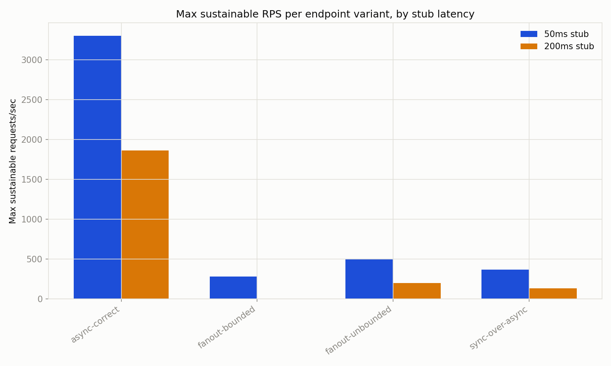
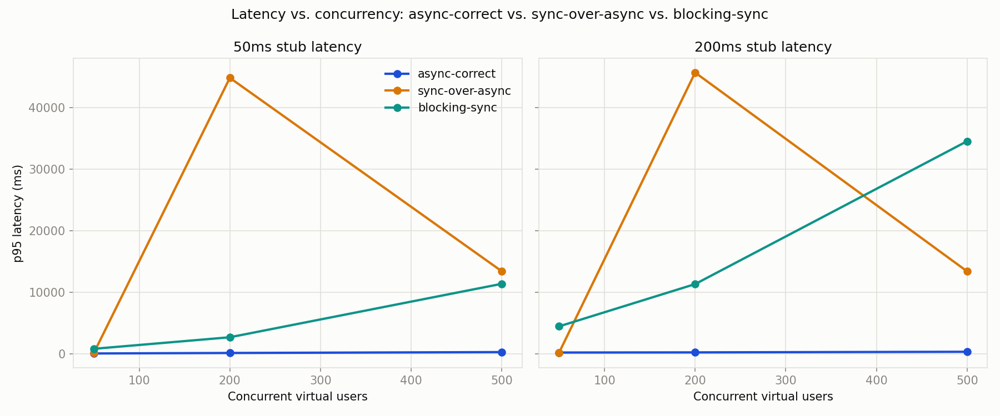
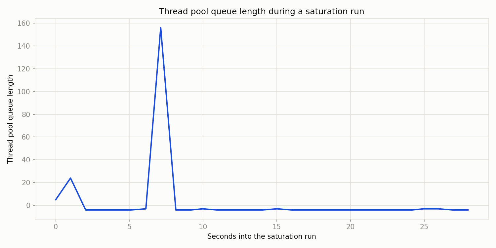
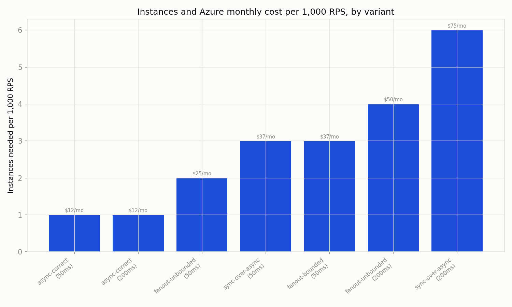

**TL;DR for leaders:** on the same 1 vCPU / 2GB container, an ASP.NET Core endpoint written with correct async/await sustained roughly 9 times the request rate of an identical endpoint that blocks on the same call (`.GetAwaiter().GetResult()` instead of `await`), before the bad version collapsed entirely under load. At 2,000 requests/second, that's the difference between 1 container and 9, or roughly $25/month versus $112/month on Azure App Service for the compute alone, scaling worse the more traffic you add. The code difference between the good and bad versions is a single line. This is a measured result from a benchmark you can run yourself, not a vendor estimate; see "Caveats" below for what it does and doesn't tell you about your own system.



## The benchmark

The API is an ASP.NET Core 10 minimal API with eight endpoints, each doing identical business logic (one downstream HTTP call, or in the fan-out cases, several) but handling concurrency differently: `async-correct`, `sync-over-async`, `blocking-sync`, `fanout-unbounded`, `fanout-bounded`, `async-no-cancellation`, `async-with-cancellation`, and a `cpu-bound` control that does no I/O at all. A separate stub service simulates a downstream dependency with a fixed, configurable latency (50ms or 200ms). The API container is constrained to 1 vCPU / 2GB; the stub is unconstrained.

I defined "sustainable" the same way everywhere: p95 latency under (stub latency + 250ms) and an error rate under 1%, both checked with k6. For the 50ms stub that's p95 under 300ms; for 200ms, under 450ms. Load ramps through a set of concurrency steps and I took the highest step that still met the rule as the max sustainable RPS for that variant.

**Honest scope note:** the plan going in called for five concurrency steps (50/100/250/500/1000 virtual users) and three repetitions per endpoint/latency combination. What's actually behind the numbers in this post is a reduced run, three concurrency steps (50/200/500 VUs) and one repetition each, done in a single sitting on a shared development machine. The orchestration script (`scripts/run_matrix.ps1` / `run_matrix.py`) takes the step list and repetition count as constants, so reproducing the full matrix is a config change, not a rewrite, it just takes a few hours instead of under one. One concrete consequence: `async-correct` never actually hit its ceiling in this reduced range (it was still comfortably "sustainable" at 500 VUs), so its true maximum sustainable RPS, and therefore the real gap versus the broken variants, is understated below, not overstated.

The load generator (k6, in its own container) ran on the same physical host as the constrained API container, not on separate hardware. That's a real limitation; see "Caveats."

Full companion code, including the orchestration scripts, cost model, and raw results, is at `companion-code/async-await-web-api-cloud-costs/` in this blog's repository. Everything runs in Docker; no local .NET SDK, k6, or Python install is required.

## The code

### Sync-over-async

The business logic is identical to the correct version. The only difference is this:

```csharp
// async-correct
using var response = await downstream.GetAsync(latencyMs, ct);

// sync-over-async
using var response = downstream.GetAsync(latencyMs, CancellationToken.None).GetAwaiter().GetResult();
```

At low concurrency (50 virtual users) this barely shows: `sync-over-async` still met the sustainability bar, at 367 requests/sec against the 50ms stub versus `async-correct`'s 845. Push to 200 concurrent users and it falls apart: throughput for `sync-over-async` crashed to under 5 requests/sec with p95 latency past 44 seconds, while `async-correct` kept climbing to over 2,300 requests/sec. Blocking a thread pool thread while it waits on another thread pool thread (the classic sync-over-async deadlock-adjacent pattern) doesn't degrade gracefully, it falls off a cliff once the thread pool can no longer keep up with injecting new threads fast enough.

Interestingly, the naive `blocking-sync` variant (a genuinely synchronous HTTP call, no `async` anywhere) never collapsed as completely as `sync-over-async` did, it just stayed slow (p95 over 800ms even at 50 concurrent users, never meeting the threshold). It ties up one real OS thread per request rather than compounding thread pool starvation the way sync-over-async does, so it's bad from the start but doesn't have the same catastrophic cliff. Both are wrong; they're wrong in different ways.



Watching `System.Runtime`'s thread pool counters during a saturating `sync-over-async` run shows exactly what's happening server-side: queue length spikes hard as the thread pool scrambles to inject threads fast enough, then drains once it catches up (or once k6 backs off).



### Unbounded fan-out

```csharp
// fanout-unbounded
var tasks = Enumerable.Range(0, count).Select(_ => downstream.GetAsync(latencyMs, ct));
var responses = await Task.WhenAll(tasks);

// fanout-bounded
using var gate = new SemaphoreSlim(maxDegree);
// ... each call waits on the gate before calling downstream, releases after
```

Both fan-out variants call the downstream dependency 10 times per request; `fanout-bounded` caps concurrent downstream calls at 4 with a `SemaphoreSlim`, `fanout-unbounded` doesn't. At low concurrency, unbounded actually sustained more throughput than bounded (500.6 vs. 281.6 requests/sec against the 50ms stub) - capping concurrency per request adds latency (more sequential batches) without buying back server capacity, because the real constraint here is the API container's thread pool and CPU, not the number of simultaneous outbound sockets. Neither variant stayed sustainable once concurrent users climbed past 50 in this run. The lesson isn't "don't bound fan-out" (unbounded fan-out is still a real risk under truly bursty traffic, and a slow or flaky downstream makes the unbounded case worse than this benchmark shows), it's that bounding concurrency *inside* one request doesn't substitute for right-sizing or scaling the thing serving the requests.

### Missing cancellation

```csharp
// async-no-cancellation
using var response = await downstream.GetAsync(latencyMs, CancellationToken.None);

// async-with-cancellation
using var response = await downstream.GetAsync(latencyMs, request.HttpContext.RequestAborted);
```

To make the cost of ignoring cancellation visible, k6 aborted 20% of requests mid-flight against both variants. That abort rate alone pushes both endpoints' measured error rate past this benchmark's 1% sustainability bar by design, so neither shows up as "sustainable" in the table below; that's an artifact of the test design, not a finding about cancellation itself. What's actually comparable is throughput under identical abort load: `async-with-cancellation`, which threads `HttpContext.RequestAborted` through to the downstream call, sustained somewhat lower peak throughput than `async-no-cancellation` in this run (2,190 vs. 3,231 requests/sec at 500 concurrent users against the 50ms stub). That's the opposite of what I expected walking in, and the reduced matrix (one repetition, no direct measurement of downstream calls actually cancelled vs. completed) isn't enough to say why with confidence. The honest takeaway is: cancellation propagation is worth doing (abandoned work still consumes downstream capacity and server resources if you don't cancel it), but this particular run doesn't cleanly prove the magnitude, and I'm flagging that rather than smoothing it over.

## Cost translation

Translating sustainable RPS into instance counts and dollars, at a target of 2,000 requests/second:

| Endpoint | Stub latency | Sustainable RPS/instance | Instances needed | Azure App Service $/mo | AWS Fargate $/mo | Ratio vs. best |
|---|---|---|---|---|---|---|
| async-correct | 50ms | 3,298.1 | 1 | $12 | $36 | 1.0x |
| async-correct | 200ms | 1,861.4 | 2 | $25 | $72 | 2.0x |
| fanout-unbounded | 50ms | 500.6 | 7 | $87 | $252 | 7.0x |
| sync-over-async | 50ms | 367.4 | 9 | $112 | $325 | 9.0x |
| fanout-bounded | 50ms | 281.6 | 11 | $137 | $397 | 11.0x |
| fanout-unbounded | 200ms | 199.0 | 16 | $199 | $577 | 16.0x |
| sync-over-async | 200ms | 135.0 | 23 | $286 | $830 | 23.0x |

`blocking-sync`, `cpu-bound`, and both cancellation variants don't appear here: none of them hit a sustainable data point anywhere in the tested concurrency range, so there's no "RPS per instance" to price. That's itself informative. See `results/cost_table.md` and `results/summary.csv` in the companion repo for the full table at 500 and 10,000 RPS targets too, and every underlying number.



Prices were fetched live from the Azure Retail Prices API and AWS's public Fargate price list on 2026-10-26, region `eastus` (Azure) / `us-east-1` (AWS), on-demand rates only, not reserved instances or savings plans. The Azure comparison uses a Basic B1 Linux plan (1 vCPU, 1.75GB), the closest published tier to the benchmark's 1 vCPU / 2GB container and a tier a small team would plausibly actually run; AWS Fargate is priced for an exact 1 vCPU / 2GB task. See `results/prices.json` in the companion repo for the raw data.

## When it doesn't help

The `cpu-bound` control endpoint does no I/O at all, just a fixed, deterministic chunk of CPU work (a chained SHA-256 loop calibrated to roughly 50ms of CPU time). Async/await has nothing to offer it: on a 1 vCPU container, p95 latency scaled almost linearly with queue depth, from about 2.2 seconds at 50 concurrent requests to about 25 seconds at 500, because every request is genuinely competing for the same single core with no idle time to reclaim. This is expected, not a bug, and it's the control that keeps the rest of this post honest: the gains above come from reclaiming idle time while threads wait on I/O, not from a general performance trick. If your bottleneck is CPU, not waiting, rewriting for async/await won't move the needle, and might even add a small amount of overhead for nothing.

If your service runs at modest traffic, or you're weighing the engineering cost of migrating a working but inefficient codebase, the calculus changes: a rewrite that saves two App Service instances a month doesn't justify itself in a week of billable migration work. Measure your own traffic and your own team's velocity before chasing this.

## How to find this in your own system

A few signals are worth checking before you assume this is costing you anything:

- **Thread pool starvation symptoms**: requests queueing with high p95/p99 latency while CPU usage on the box stays low or moderate. CPU-bound work looks the opposite: high CPU, latency tracks roughly linearly with load.
- **`dotnet-counters`**: attach to a running process (`dotnet-counters monitor -p <pid> --counters System.Runtime`) and watch `Thread Pool Thread Count` and `Thread Pool Queue Length` under load. A queue length that climbs and doesn't drain is the smoking gun.
- **APM traces**: look for spans where the reported "wait" or "queue" time dwarfs actual work time, especially on endpoints that call downstream HTTP services.

## Caveats

This was run on a single development machine, not isolated cloud hardware: the load generator shared the host with the constrained API container, and the numbers reflect one CPU generation under Docker Desktop, not a clean cloud VM. Treat the absolute RPS figures as directional, not a guarantee of what you'll see in production; the *relative* comparison between variants, measured under identical conditions, is the part worth trusting. See `results/environment.md` in the companion repo for exact specs.

This also isn't the full planned benchmark matrix. See the post's methodology section and the companion repo's README for exactly what was reduced and why, and how to run the full matrix yourself.
